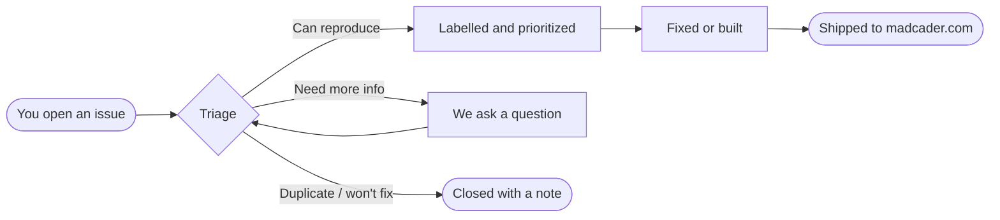

  <a href="https://madcader.com">
    <picture>
      <source media="(prefers-color-scheme: dark)" srcset="assets/wordmark-dark.svg">
      
    </picture>
  </a>

  <strong>Design aluminum-extrusion frames in your browser.</strong> 
  This is where MadCADer's bug reports, feature ideas and roadmap live in public.

  
  
  

  <a href="https://github.com/Elohveee/madcader-issues/issues/new?template=bug_report.yml"><b>🐞 Report an issue</b></a>
  &nbsp;·&nbsp;
  <a href="https://github.com/Elohveee/madcader-issues/issues/new?template=feature_request.yml"><b>💡 Request a feature</b></a>
  &nbsp;·&nbsp;
  <a href="https://madcader.com"><b>🛠️ Open MadCADer</b></a>

---

## 👋 Hello, builder

MadCADer is a 3D designer for T-slot aluminum frames, from workbenches and enclosures to printer frames and whatever else you're bolting together. You place beams, snap them together with real connector hardware, and get a cut list and parts count you can order from.

The code is private, but **this repo is fully public**. Anyone with a GitHub account can file, read, upvote and follow issues here.

You can also get here from inside the app:

| Where | How |
| :--- | :--- |
| Account menu (your avatar, top right) | **Report Issue** · **Feature Request** |
| Keyboard shortcuts dialog (press <kbd>?</kbd> in the editor) | the 🐞 and 💡 buttons in its header |

## 🐞 Found a bug?

**[Open a bug report →](https://github.com/Elohveee/madcader-issues/issues/new?template=bug_report.yml)**

The reports that get fixed fastest have:

1. **Steps someone else can follow.** For example: *"New model → add a 40×40 beam → connect a second beam at 90° → the corner bracket floats 2 mm off the face."*
2. **What you expected to happen**, and what happened instead.
3. **A screenshot or screen recording.** You can drag one straight into the form, and 3D problems are much easier to see than to describe.
4. **Your browser and OS.** MadCADer runs on WebGL, so a lot depends on the browser.

> [!TIP]
> If the editor freezes or shows nothing, open the browser console (<kbd>F12</kbd> → **Console**) and paste any red error lines into your report.

## 💡 Have an idea?

**[Suggest a feature →](https://github.com/Elohveee/madcader-issues/issues/new?template=feature_request.yml)**

Start with **what you're trying to build**, not just the button you'd like. *"I keep re-drawing the same 4-beam rectangle for shelves"* tells us more than *"add copy/paste."* There may be a better fix than the first one that comes to mind.

Before you post, **search the existing issues** and add a 👍 to the one that matches. We look at reactions when deciding what comes next.

## 🔁 What happens after you post

| Label | Meaning |
| :--- | :--- |
|  | Something is broken |
|  | A new feature or improvement |
|  | We need more information from you |
|  | Already tracked in another issue (linked) |
|  | Out of scope for now. We'll explain why. |

Changes ship straight to [madcader.com](https://madcader.com). When a fix goes live, the issue is closed with a comment, and if you're subscribed you'll get a notification.

## 🔒 A note on privacy

Issues here are **public**. Please don't post passwords or private details, and don't attach a model file you don't want the world to see. If you need to share something sensitive, mention that in the issue and we'll find a private way to get it.

---

  Made with too many T-nuts · <a href="https://madcader.com">madcader.com</a> · <a href="https://madcader.com/privacy">Privacy</a>

